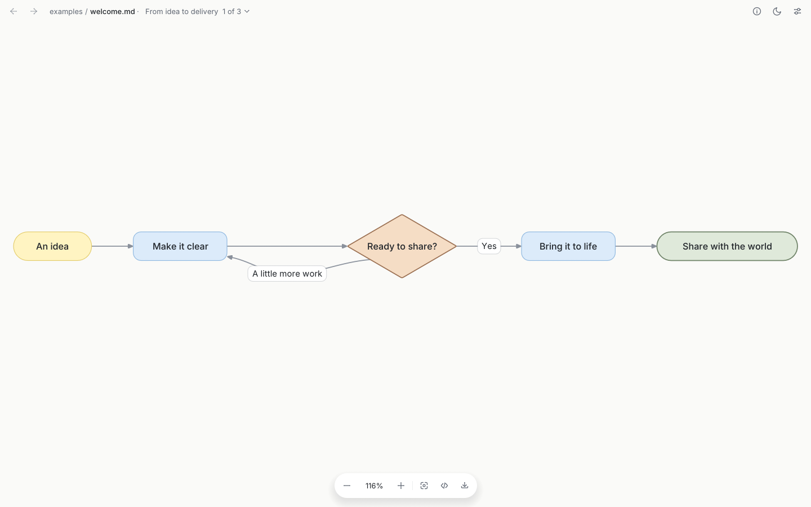
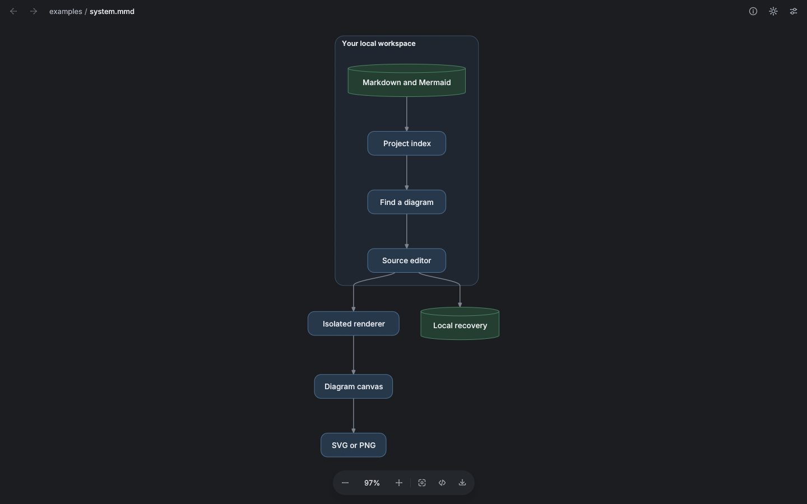
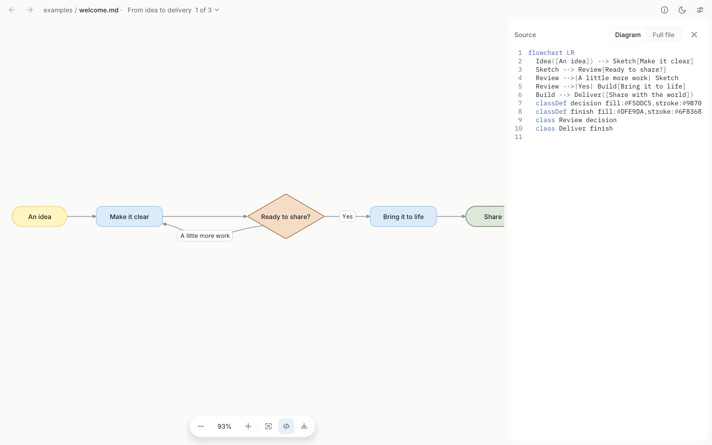
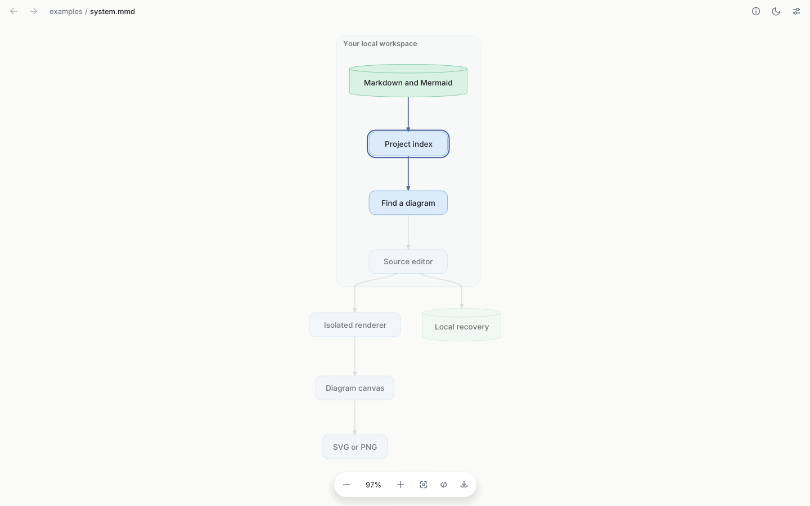
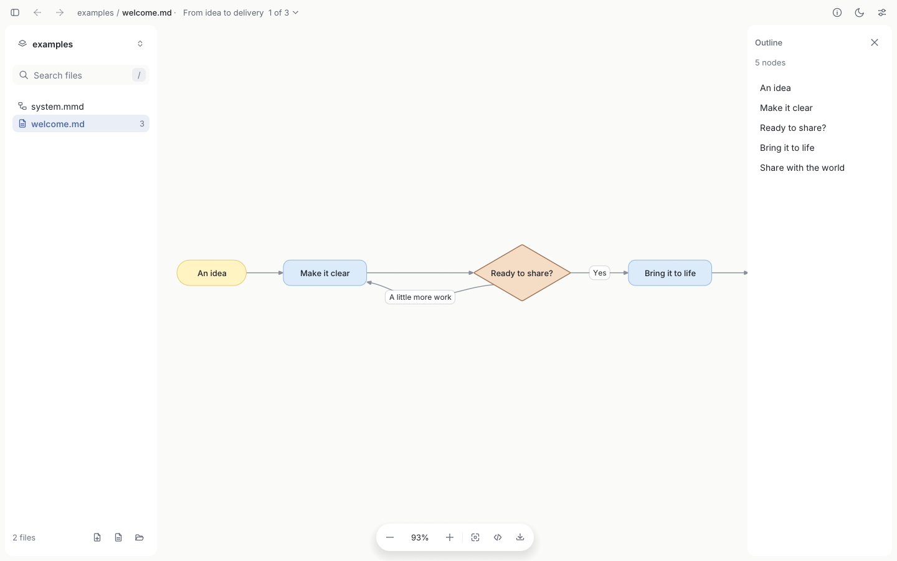

# Tidemap

Fast, native desktop viewer and editor for Mermaid diagrams in local Markdown and `.mmd` files.

Pure Rust: egui UI, in-house diagram engine. No Electron, WebView, JavaScript or browser. Single ~20 MB binary, fully offline. Windows, macOS, Linux.

| Light | Dark |
|---|---|
|  |  |
|  |  |



## Features

- Open a folder: file tree, search, pins, recent projects, multiple diagrams per Markdown file.
- Markdown files open as a rendered page: headings, lists, tables, quotes, code, links, selectable text, and every Mermaid block drawn inline (double-click one to open it, `Ctrl+Shift+M` switches views).
- Source editor built for big files: only visible lines are laid out, so typing, selecting and moving cost the same in a 400,000-line file as in a 10-line one. Undo/redo, word and line selection, multi-line indent, line move/delete, list continuation, find with next/previous.
- Live preview while typing; last good picture kept on syntax errors.
- Click a node to highlight neighbours and jump to its source line, and vice versa.
- Pan, zoom, fit, minimap, outline, in-diagram search, light/dark.
- Export SVG or PNG (1x–3x).
- Safe save, autosave, crash recovery, external-change handling.
- Keyboard-first: `Ctrl+P` find, `Ctrl+Shift+P` commands, `Ctrl+/` full shortcut list.
- Colours and geometry editable in `style.json` (live reload).

## Install

Grab the archive for your platform from [Releases](../../releases) and verify it with the matching `.sha256` file.

| Platform | Archive | Run |
|---|---|---|
| Windows x86_64 | `.zip` | unzip, run `Tidemap.exe` |
| macOS Apple Silicon / Intel | `.tar.gz` | extract, `./tidemap`; unsigned, so first run: right-click → Open (or `xattr -d com.apple.quarantine tidemap`) |
| Linux x86_64 | `.tar.gz` | extract, `./tidemap`; needs GTK 3 for file dialogs; `tidemap.desktop` + `tidemap.png` included for a launcher |

Release archives for all platforms are built by GitHub Actions on every `v*` tag.

## Benchmarks

Parse + layout + scene build of generated flowcharts, best of 5, release build, Intel Core i7-14700K (20 cores, layout is multithreaded). Reproduce with `cargo native bench`.

| Topology | Nodes | Edges | Parse | Layout | Scene | **Total** |
|---|---:|---:|---:|---:|---:|---:|
| chain | 200 | 199 | 0.1 ms | 0.3 ms | 0.0 ms | **0.5 ms** |
| chain | 2,000 | 1,999 | 1.1 ms | 3.4 ms | 0.5 ms | **5.1 ms** |
| chain | 10,000 | 9,999 | 5.7 ms | 14.1 ms | 3.1 ms | **22.9 ms** |
| tree | 200 | 199 | 0.1 ms | 0.5 ms | 0.0 ms | **0.6 ms** |
| tree | 2,000 | 1,999 | 1.1 ms | 7.0 ms | 0.5 ms | **8.6 ms** |
| tree | 10,000 | 9,999 | 5.4 ms | 14.1 ms | 3.0 ms | **22.6 ms** |
| dense layered | 200 | 360 | 0.2 ms | 2.4 ms | 0.1 ms | **2.7 ms** |
| dense layered | 2,000 | 3,960 | 1.9 ms | 23.4 ms | 0.8 ms | **26.2 ms** |
| dense layered | 10,000 | 19,960 | 9.4 ms | 317.7 ms | 9.2 ms | **336.3 ms** |
| subgraphs | 200 | 212 | 0.1 ms | 5.8 ms | 0.1 ms | **5.9 ms** |
| subgraphs | 2,000 | 2,120 | 0.8 ms | 38.2 ms | 0.6 ms | **39.6 ms** |
| subgraphs | 10,000 | 10,600 | 4.5 ms | 99.7 ms | 4.5 ms | **108.7 ms** |

Even 10,000-node diagrams lay out in well under half a second. Bench measures the engine, not window startup or painting.

## Build

Rust toolchain is pinned in `rust-toolchain.toml`.

```text
cargo native build     release build
cargo native run       open the app
cargo native package   portable zip in release/
cargo native bench     engine timings
cargo test --workspace run tests (9, all in crates/diagram)
```

- Windows: GNU or MSVC toolchain (GNU needs no Visual Studio; see [docs/BUILD_REPORT.md](docs/BUILD_REPORT.md)).
- macOS: nothing extra.
- Linux: `sudo apt install libgtk-3-dev libxkbcommon-dev libwayland-dev libx11-dev` (or distro equivalent).

## Mermaid support

- Supported: `flowchart` / `graph` — all node shapes, edge kinds, labels, subgraphs, `classDef`, `class`, `style`, `linkStyle`. See [compatibility](docs/COMPATIBILITY.md).
- Not yet: sequence, state, class, ER and other families (shown as a "not supported" card; source stays editable).
- `%%{init}%%` themes are ignored. Layout differs from Mermaid.js; no JS fallback.
- Limits: 20,000 nodes/edges, 2 MiB source.

## Dev hooks

`TIDEMAP_SHOT=<png>` renders a screenshot headlessly (plus `_SIZE`, `_THEME=dark`, `_SELECT`, `_SOURCE`, `_FOLDER`, `_OUTLINE`, `_DIALOG`); `TIDEMAP_EXPORT=<svg|png>` exports from CLI. Screenshots above were made this way.

`TIDEMAP_SLOWMO=<n>` plays every animation `n` times slower, to inspect motion. `TIDEMAP_FRAME_LOG=1` prints `frame <ms>` to stderr for every frame in which something animates.

Motion follows the system's animation setting. The Motion row in Settings (System, Reduced, Full) overrides it; Reduced keeps fades but drops movement. The command palette has a Toggle reduced motion command.

`TIDEMAP_SLOWMO=<n>` plays every animation `n` times slower, to inspect motion. `TIDEMAP_FRAME_LOG=1` prints `frame <ms>` to stderr for every frame in which something animates.

Motion follows the system's animation setting. The Motion row in Settings (System, Reduced, Full) overrides it; Reduced keeps fades but drops movement. The command palette has a Toggle reduced motion command.

## Layout

```text
src/             egui app
crates/diagram/  parser, layout, scene, SVG writer
crates/core/     files, index, source maps, recovery
crates/renderer/ render jobs, cache, SVG/PNG export
crates/model/    shared types
tools/xtask/     build, package, bench
docs/            index in docs/README.md: decisions, status, compatibility
```

Fonts: Inter and IBM Plex Mono (SIL OFL). See [THIRD_PARTY_NOTICES.md](THIRD_PARTY_NOTICES.md).
