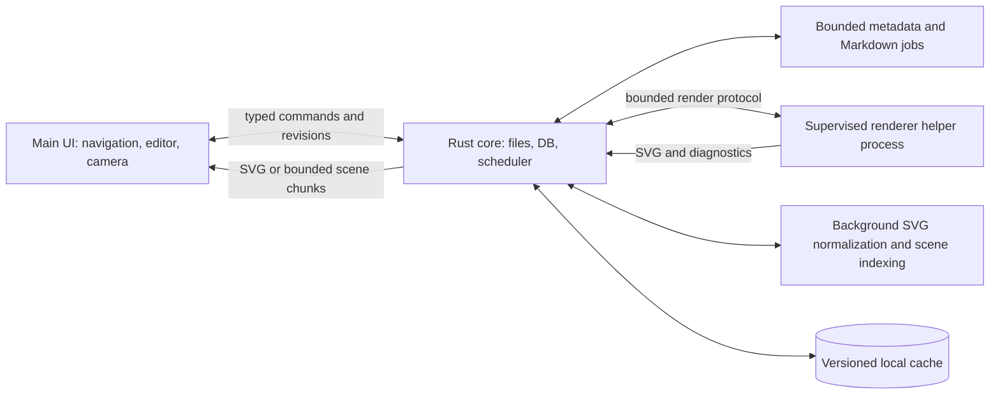

# Architecture and performance strategy

> **Historical sections.** The sections below that describe Tauri, a WebView, Mermaid.js, a Svelte/TypeScript UI and a supervised render helper were written before the native decision and are kept as history. The implemented system is described by [ADR 001](decisions/001-implementation-runtime.md) (native Rust application, egui/eframe) and [ADR 002](decisions/002-own-diagram-engine.md) (in-house diagram engine, in-process worker thread, no child process). Where this document disagrees with them, the ADRs win.

**Decision status:** provisional, subject to P0 measurements. This document specifies behavior and interfaces; it does not claim that a framework automatically delivers the budgets in the PRD.

## 1. Stack decision

| Layer | Proposed choice | Reason and constraint |
|---|---|---|
| Desktop shell | Tauri 2 | Native integration with system WebViews. Confirm engine compatibility and renderer isolation on every OS. |
| Files, indexing, persistence, supervision | Rust | Bounded background jobs, native filesystem handling, predictable ownership. Keep blocking work off the UI event loop. |
| UI | TypeScript, Svelte, Vite | Small reactive shell; no server or SSR. Canvas/editor state updates must not rerender the file tree. |
| Source | CodeMirror 6 | Viewport-oriented editing and transactions. Do not duplicate entire documents into reactive state on each keystroke. |
| Compatibility rendering | Exact pinned Mermaid release | Maintain upstream syntax/diagram behavior. Lock versions and validate upgrades against the corpus. |
| Large presentation | Normalized SVG scene + Canvas 2D, proposed `usvg` adapter | Reuse Mermaid layout while bounding main-window DOM. Faithfulness is a feasibility gate, not an assumed library capability. |
| Persistence | SQLite + app-data cache files | Searchable metadata, history, recovery and versioned cache; no generated files in the repository. |
| Discovery/watch | Rust traversal and native watch library, candidates `ignore`/`notify` | Respect ignore rules, coalesce events, recover from overflow. Select exact dependencies during P0. |

Tauri uses WebView2 on Windows, WKWebView on macOS, and WebKitGTK on Linux. An iframe or another WebView is **not a proven independent execution boundary**. Therefore the renderer must be a separately launched, supervised helper OS process. See the [Tauri process model](https://v2.tauri.app/concept/process-model/).

P0 must prove a packaged helper can host bundled Mermaid, perform actual DOM/font measurement, return output, and be terminated/restarted without disrupting the main window on all targets. Prefer a helper built from the same Rust workspace with a restricted render-only WebView and no repository authority. Test macOS bundle/lifecycle rules, Linux display/session behavior, and Windows child-process cleanup explicitly.

Its DOM must have a real measurable viewport while remaining out of the user's way; `display: none` is not a valid measurement surface. Check background throttling and font readiness rather than assuming offscreen views behave like visible views.

If this helper cannot meet compatibility, cancellation, distribution, or memory requirements, evaluate an **Electron shell with a separate sandboxed rendering process** using the same frontend/protocol/corpus. Electron provides a documented renderer process model; verify isolation and lifecycle empirically there too. A larger runtime is an explicit tradeoff, not grounds to accept an unresponsive shell. Record the decision after measurements; do not ship two desktop shells.

## 2. Boundaries



The diagram describes application responsibilities, not a guarantee that every box is a unique OS process. Mermaid rendering is the mandatory separate process. Scene conversion may run in that helper or a second supervised worker if profiling shows it also needs hard termination. Main-core worker threads alone cannot safely terminate runaway native computation.

The helper receives diagram text, approved render configuration, bundled font identifiers, and job IDs. It does not receive file paths, broad filesystem APIs, network access, or a general Tauri command bridge. Platform code signs and launches a known packaged binary; never invoke an arbitrary shell command from diagram content. The supervisor owns the helper's descendants and closes them on cancel/exit.

## 3. Rendering paths

### A. Standard compatibility path

1. Extract the selected block and its source map. Compute a source/config/font/version key.
2. Return a valid cached artifact if available, while verifying the file revision.
3. Dispatch to the helper after the edit debounce. Serialize jobs within each Mermaid instance because configuration and rendering may carry shared state.
4. Await font readiness. Render with upstream Mermaid, `startOnLoad: false`, strict security and a bounded resource policy.
5. Preflight and sanitize the returned SVG in background work. Validate byte size, element count, depth, references, dimensions, filters, and active/external content.
6. Mount SVG in an isolated style boundary in the UI only if measured DOM and complexity limits are safe. Namespace all IDs/references per artifact to prevent collisions; scoped artifact CSS cannot affect shell controls.
7. Publish only if workspace, document, block, source, configuration, and job revisions still match. Dispose previous artifact resources.

Initial SVG cutover candidate: 8,000 elements or 8 MiB serialized output, plus path/filter complexity checks. P0 must tune these using actual mount/frame costs. A byte count or node count alone is not sufficient.

Mermaid's API returns SVG, while `parse()` reports validity and diagram type; it does not supply a documented general-purpose graph AST. DOM-based rendering cannot simply be moved wholesale into a Web Worker. See [Mermaid usage](https://mermaid.js.org/config/usage.html). Any internal graph/source adapter must be separately version-pinned and tested.

### B. Large-scene presentation path

Do not mount a giant SVG and call it optimized. Preserve the upstream layout, then convert its static presentation into a compact display list:

1. Render in the helper under a time/memory budget.
2. Resolve SVG styles, transforms, text metrics, markers, clipping, and references into normalized geometry. Investigate `usvg`, which resolves supported SVG features to a simpler tree; it also ignores unsupported features, so a strict feature audit must precede acceptance. See the [upstream usvg feature/limitation list](https://raw.githubusercontent.com/linebender/resvg/main/crates/usvg/README.md).
3. Preserve paint order, groups, label strings, source/semantic metadata when available, and conservative visual bounds including strokes/markers. Text can be shaped to paths for faithful display; keep a parallel text representation for search and accessibility.
4. Build a packed spatial index over visual bounds off the UI thread. Transfer display-list chunks with backpressure; build expensive `Path2D` objects incrementally or in a validated canvas worker. Do not construct the entire scene synchronously in the main window. Use binary IPC payloads or channels, never JSON-encoded geometry; P0 measures the transfer stage on each engine.
5. Query visible geometry plus overscan; paint it with Canvas 2D. Keep overlay controls and the accessible outline in a small DOM.
6. Cache the scene and overview. Close evicted bitmap/GPU resources and release geometry buffers.

Begin with a strict subset covering the bundled Mermaid corpus. Filters, masks, nested clips, images, rich labels/`foreignObject`, math, and CSS inheritance require explicit parity cases. Never assume a normalized result is complete because conversion returned successfully. For standard diagrams, unsupported scene features can use the bounded SVG path. For huge diagrams, use a proved bounded raster fallback if P0 establishes one, or show an honest unsupported-feature state with source access. No silent omission or blank “success.”

Use `htmlLabels: false` for the app's large-mode profile where compatible; do not silently apply it to an authored diagram whose rich-label meaning would change. The compatibility matrix must identify these distinctions. Mathematical and icon-heavy fixtures are mandatory.

This path reduces display cost **after layout**. It does not accelerate Mermaid parsing or global layout. If huge layout itself fails, optimize that stage or change the engine; canvas cannot repair the bottleneck.

### C. Structural optimization, only if measurements require it

If B cannot meet huge-tier layout budgets, build a narrow flowchart adapter using a pinned upstream diagram database/AST integration and differential tests. Do not create a regex-based Mermaid parser. Reject unsupported constructs visibly and fall back to compatible rendering where bounded.

Build adjacency lists, identify weak components and strongly connected components, and compare upstream layout settings versus independent-component layout. Pack independent components without changing intra-component relationships. Respect compound groups, ports, edge labels, direction, and crossing-group edges; these can prohibit partitioning. Preserve all original arrows after any cycle-breaking operation.

ELK can execute layout in a Web Worker, but Mermaid integration must be verified separately. See [elkjs worker support](https://github.com/kieler/elkjs). Current Mermaid documentation describes bundled/default ELK starting in v12; do not follow older instructions that assume Dagre or a separate ELK package. Benchmark the pinned version's actual defaults and alternatives. See [Mermaid layouts](https://mermaid.js.org/config/layouts).

Path C is an evidence-triggered dependency for the huge gate, not an automatic rewrite of every diagram renderer. If required, insert it before claiming the huge requirement is complete.

Component partitioning only helps graphs that split. A single connected 10,000-node component gains nothing from it, so the P0.0 layout probe must include connected topologies and report them separately. If connected huge fixtures cannot meet the budget with any upstream layout setting, that is an owner decision about the huge-tier corpus or a different layout engine for that tier, recorded in an ADR. The adapter cannot absorb it.

### D. Presentation presets

`Authored` and `Warm` ([DESIGN.md](DESIGN.md) §6) are render configuration, not post-processing. Warm is expressed through the pinned Mermaid release's supported theme variables, bundled font settings and scoped theme CSS, supplied in the approved render configuration. It therefore changes measurement and layout and is part of `effective_config` in the RenderKey.

Authored styling (`classDef`, `style`, frontmatter theme settings) takes precedence over the preset; security-relevant options stay app-controlled. Role treatments keyed to shape apply only through selectors verified against the pinned release in the family corpus; where no verified selector exists the node gets the restrained default. Never rewrite geometry after layout, and never write preset data into the source file.

Preset plumbing lands with the standard path in P2 so benchmarks and caches reflect the real default presentation; P4 only tunes values.

## 4. Algorithms and complexity

| Problem | Strategy | Cost and limitation |
|---|---|---|
| Repository discovery | One metadata traversal, ignore pruning, eligible-extension filtering, progressive batches. | O(entries visited); avoid opening unrelated file contents. |
| Markdown extraction | CommonMark parser/source spans; parse active buffer incrementally where supported, background full validation as needed. | Initial O(document bytes); no unsafe fence regex. |
| File/diagram search | Path/title normalization, prefix/token/trigram candidate index, bounded fuzzy ranking and top-k heap. | Build O(indexed text); candidate query depends on matches. Broad-query worst case can be O(total candidates), so limit work and support cancellation. |
| File tree | Flatten expanded tree; window visible rows plus overscan. | DOM O(visible rows); never recursively render every file. |
| Trace / reachability | Adjacency lists and BFS with visited set and result budget. | O(V+E) worst case; one-hop work proportional to relevant degree. |
| Components/cycles | DFS/union-find for connectivity; Tarjan/Kosaraju for SCCs. | O(V+E); layered layout and edge routing are more expensive and have no general linear-time promise. |
| Spatial visibility | Packed R-tree over static visual bounds. | Build typically O(P log P), query often O(log P+K), worst-case O(P). P is primitive count, K visible primitives. |
| Hit testing | Spatial candidates, then geometry checks, with screen-space tolerance. | Typical small candidate set; high-overlap scenes need a bounded fallback. |
| Viewport painting | Stable paint order, culling, precomputed paths, discrete detail levels. | O(K) geometry work; if the whole graph is visible K can equal P. |

At overview zoom, even viewport culling selects most of the graph. Use an already generated bounded overview bitmap or simplified summary, then progressively refine. Never allocate a full-resolution image of the entire world bounds. Labels appear by screen-space size; selected/search labels have priority. Long spanning edges must be spatially indexed by their segments or conservative bounds, not just endpoint positions.

Use full-quality geometry when settled, reduced detail during gestures, and bounded raster tiles only when profiling warrants them. Tile caches use discrete zoom buckets and a byte budget. A renderer that replays the entire SVG for every visible tile is not an acceptable scaling strategy.

## 5. Scheduling and cancellation

- One foreground render helper initially; one optional neighbor prefetch only when idle and within the memory budget. Do not pre-render the project.
- Helper lifecycle: start the helper after the shell is interactive, never on the startup path; keep it warm while a workspace is open; restart it after a kill. P0.2 measures helper cold start to first-render-ready on every target. If that restart makes the post-cancel preview budget in PRD §6 unreachable, keep one pre-warmed spare and count its memory inside the idle and working-set budgets; otherwise hold no spare. Report idle memory with the helper policy stated.
- Priority: active user navigation, active revision render, visible-file metadata, search indexing, speculative cache work.
- Edit debounce starts at 180 ms for ordinary diagrams and up to 450 ms for previously expensive ones. Derive adaptation from measured recent render time; display that a preview is pending.
- Latest revision replaces queued older revisions. Active obsolete jobs are canceled cooperatively when possible; otherwise the supervisor kills/restarts the helper. Apply a small coalescing window to avoid restart thrashing during continuous typing.
- Cancel returns UI feedback within 50 ms. Process cleanup target is ≤500 ms, tested separately. Drop late messages after cancellation regardless of helper state.
- Candidate job budgets: standard 3 s, large 8 s, huge 20 s, user-requested extended retry 60 s. Expected latency targets remain stricter. Stop repeat-crashing source hashes until an explicit retry or source change.
- Track RSS for the full process tree. Stop work before the total 1 GiB huge budget using measured helper allocation headroom. Bound output bytes/geometry/image dimensions as well as time; OS memory accounting and enforcement differ by platform and require P0 proof.

A `Promise.race()` timeout is insufficient: it abandons the result without stopping computation. An iframe is insufficient: it need not isolate the event loop. Both stale-result rejection and actual termination must be tested.

## 6. Data and revision model

```text
Workspace: id, canonical_root, settings_revision, scan_generation
File: id, root_relative_path, platform_file_id?, size, mtime, content_hash?, scan_state
Diagram: id, file_id, heading_path, source_span, occurrence_hint, source_hash, type
Buffer: file_id, base_disk_hash, revision, dirty, recovery_revision
ViewState: diagram_id, camera, selection?, editor_position, timestamp
FileState: file_id, last_diagram_id, editor_mode, editor_cursor, editor_scroll
Navigation: workspace_id, bounded history entries, pinned diagram_ids, recent workspaces
RenderKey: source_hash + effective_config + engine_version + font_hashes
           + renderer_schema + profile + relevant_platform_metric_fingerprint
RenderJob: job_id + workspace_generation + file_id + diagram_id + buffer_revision + RenderKey
Artifact: RenderKey, kind, diagnostics, byte_size, bounds, schema_version
```

Use content hashes for artifact identity. Size/mtime are cheap candidates for change detection, not authoritative correctness checks. Before displaying a persisted artifact after startup, verify its source revision; a low-priority hash check cannot silently bless stale content. When a file is being hashed, distinguish a remembered preview from a verified-current preview.

Block identities combine file identity, heading context, prior span alignment and content fingerprints. Reconcile duplicates conservatively; ordinal-only IDs are unstable after insertions. Markdown block edits must honor indentation/container prefixes and newline conventions; use a reversible source map, not naïve substring replacement. If content would close its fence, safely lengthen/convert the fence or require full-file editing with an explicit explanation.

Define offset units in the protocol: canonical file spans use UTF-8 byte offsets; editor positions use UTF-16 code units with an explicit line/offset conversion index. Carry container-prefix mappings for extracted blocks. Test astral characters, combining marks and CRLF so diagnostics and patches address the same text in Rust and JavaScript.

Use a byte-accounted LRU: initial decoded-artifact budget 96 MiB, disk cache 512 MiB, both configurable and included in process budgets. Active artifacts are accounted for separately. Keep neighbor metadata cheap; cached does not mean every scene is decoded. Cache corruption/version mismatch triggers eviction and recomputation.

## 7. Filesystem correctness

Core APIs accept workspace/file IDs and validated relative paths, not arbitrary frontend-supplied absolute paths. Enforce root boundaries using native handles/canonicalization; defend against symlink races. Do not follow directory symlinks by default. Permit explicit outside-root file opening as a separately scoped resource. Handle case-sensitive filesystems, Unicode normalization, UNC paths, and volume changes.

Writes use a temporary sibling, durable flush as supported, platform-correct atomic replacement, and explicit error reporting. Validate expected on-disk identity/hash immediately before replacement; use locking where supported. There is no portable atomic compare-and-swap with every non-cooperating external editor on every filesystem: document the residual race, keep recovery snapshots, and test actual OS behavior. Do not promise impossible universal atomicity or fall back to destructive in-place overwrite on rename failure.

Respect BOM and CRLF/LF; preserve every unchanged Markdown byte. Default to UTF-8; detect and explain unsupported encodings instead of replacing characters on save. Externally clean buffers reload. Dirty buffers preserve both versions and show a conflict choice. Handle disk-full, antivirus locks, read-only files, network folders, partial writes, and interrupted saves.

Watchers coalesce changes by file identity/path and distinguish self-save events. On queue overflow, watch limits, or unavailable recursive watching, show degraded status and run bounded incremental reconciliation. Polling has adaptive backoff; inactive/network workspaces must not create a hot loop. Full content indexing is lower priority and pausable.

## 8. Safety, export, and diagnostics

Strict Mermaid security, a restrictive CSP, no remote script/font/image loading, no arbitrary callbacks, and SVG sanitization are default boundaries. Resolve allowed bundled assets through a fixed registry. Disable source-controlled security overrides, active links, and unbounded `maxEdges`/`maxTextSize`; derive finite limits from the accepted render profile. Never use `Infinity` to “support huge diagrams.”

The SVG normalization library may load external resources unless configured otherwise: disable those resolvers explicitly. Audit `href`, CSS `url()`, entity expansion, oversized embedded data, recursion, and decompression. Opening a local document should not grant it app privileges.

Export runs outside the UI thread against an identified artifact revision. SVG exports preserve faithful geometry and licensing obligations for embedded assets. PNG exports enforce dimension/byte limits and offer bounded output scale or multiple tiles. Export never rerenders a huge graph synchronously in the main window.

Record local stage timings for discovery, extraction, hashing, parse/layout, SVG generation, normalization, transfer, scene preparation, paint, and cache hit/miss. A diagnostics panel exports opt-in reports with paths/source excluded by default. Capture full process-tree memory and backend/engine versions. Disable expensive traces in normal operation; no telemetry service is required.
