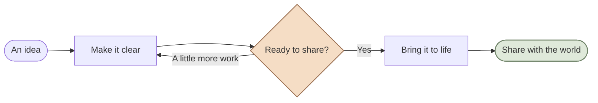
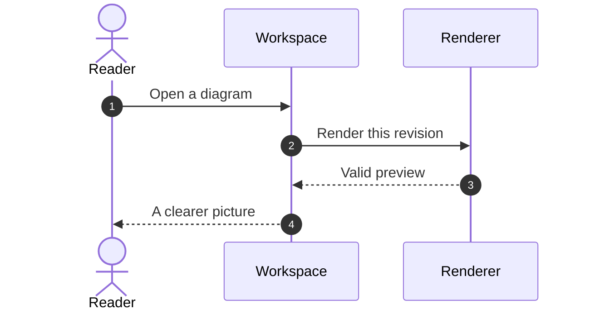
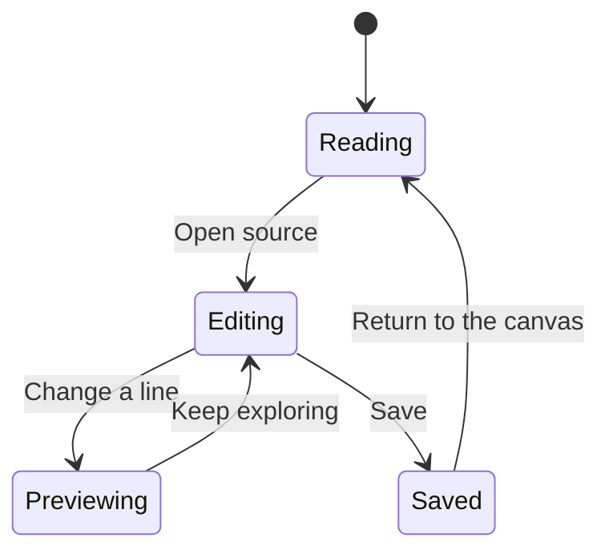

# A little clarity

This example belongs to MermaidLite. Open the `examples` folder to explore the reading and editing workflow.

## From idea to delivery

## A conversation between parts

## Keep the important things

