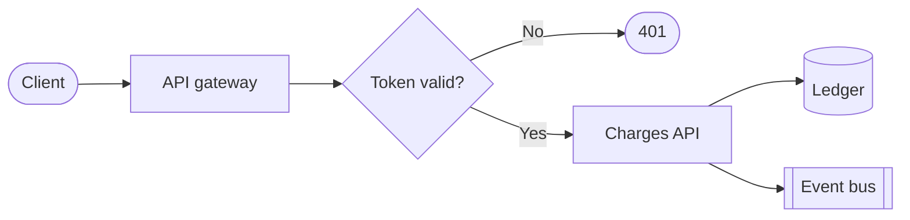
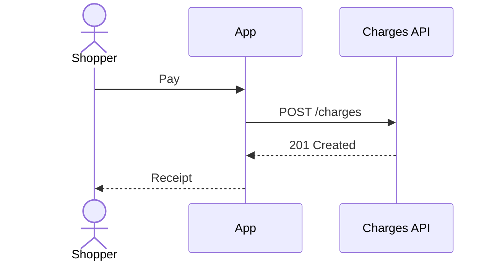
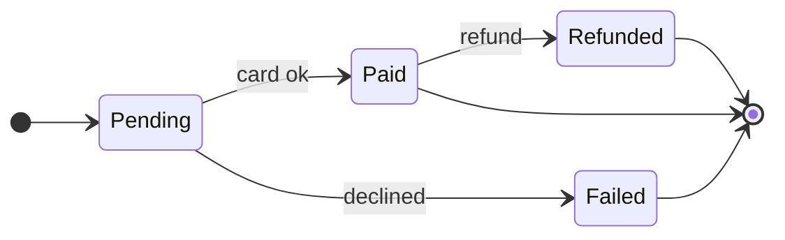

# Payments service

The diagrams in this file are drawn on the Tidemap landing page by the real engine.
`python tools/site/build.py` exports them again after an engine change.

## Request path

## Checkout

## Charge lifecycle

